<div align="center">

# PhysMoE

**PhysMoE: Fast Spatial Grounding with Single-Token Coordinate Representation
in Modality-Decoupled VLMs**

<a href="resource/PhysMoE.pdf"></a>
<a href="https://huggingface.co/RomanTHT/PhysMoE"></a>

[Overview](#overview) · [Gallery](#gallery) · [Installation](#installation) · [Quick Start](#quick-start) · [Prompt Format](#prompt-format) · [Examples](#examples) · [Architecture](#architecture)

</div>

<p align="center">
  <a href="resource/Unified_Pixel_Space_Symmetric_Final.pdf">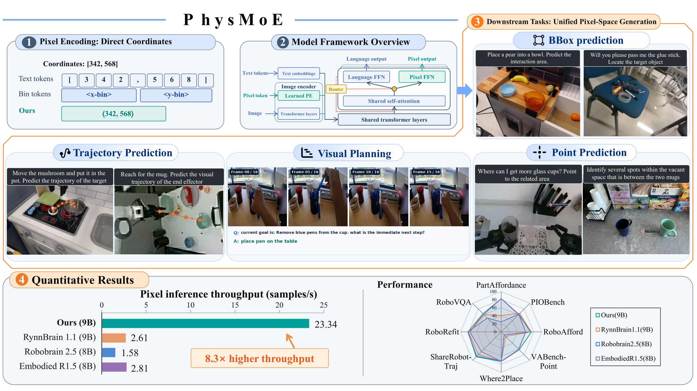</a>
</p>

---

## News

- **2026-11** — The [paper](resource/PhysMoE.pdf), inference code, example scripts and qualitative results are released.
- **Coming soon** — Model checkpoints on [Hugging Face](https://huggingface.co/RomanTHT/PhysMoE) (training is ongoing).

## Overview

Vision-language models usually write coordinates as text, e.g. `"[307, 244]"`: several digit tokens per
number, a classification loss that does not know `307` is close to `308`, and an LLM feed-forward
network that has to serve both language and geometry.

**PhysMoE** treats a 2D point as a first-class token:

- **One token per point.** A normalized point `(x, y) ∈ [0, 1]²` is a single coordinate token, written
  `<|x,y|>` in text. With 1000 bins per axis the resolution is 1/999 of the image side.
- **Coordinate tokens are embedded spatially.** Their input embedding is read from the vision encoder's
  2D position table by bilinear interpolation at `(x, y)`, so the LLM sees where the point is in the
  image instead of a learned lookup ID.
- **A router picks text or coordinate for each token.** A small router MLP decides whether the next token is
  text or a point. In the last *K* decoder layers each token goes to one of two FFN experts:
  the original language FFN or a dedicated **pixel FFN**. Attention is shared.
- **Points are regressed, not classified.** For point tokens a continuous head outputs `(x, y)` directly
  and is trained with a Smooth-L1 loss. Text tokens use the usual LM head.

One model therefore handles:

| Capability | Output | Example prompt |
|---|---|---|
| Affordance / referring **pointing** | `<\|x,y\|>` (one or more) | `You need to grasp the mug. Predict the affordance area for grasp. Type: point` |
| **Bounding-box** grounding | `<\|x1,y1\|><\|x2,y2\|>` per box | `I need to pick up the whiteboard marker. Locate the target object. Type: bbox` |
| **Trajectory** prediction (end-effector / object) | `<\|x,y\|>,<\|x,y\|>,...` | `"reach for the mug". Predict the visual trajectory of the end effector. Type: trajectory. Lim: 4` |
| Embodied **VQA / planning** | free text | `current goal is: Remove blue pens from the cup. what is the immediate next step?` |

## Gallery

Qualitative results of **PhysMoE-9B**. The prompt is shown above each image and the model's prediction is drawn on it.

### Pointing

<table>
<tr><td width="25%">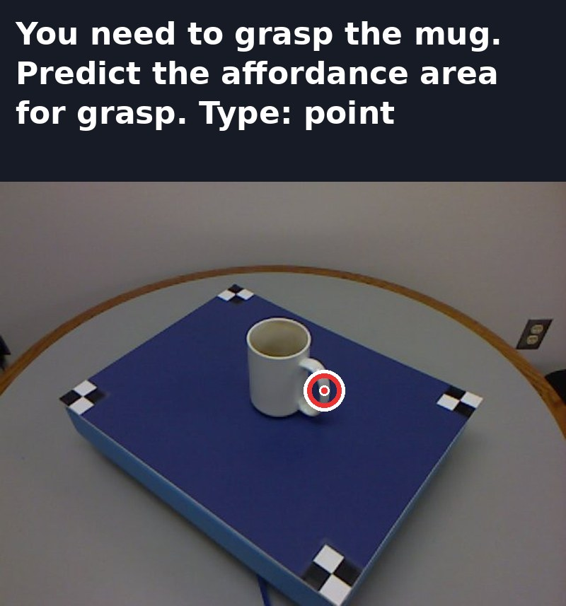</td><td width="25%">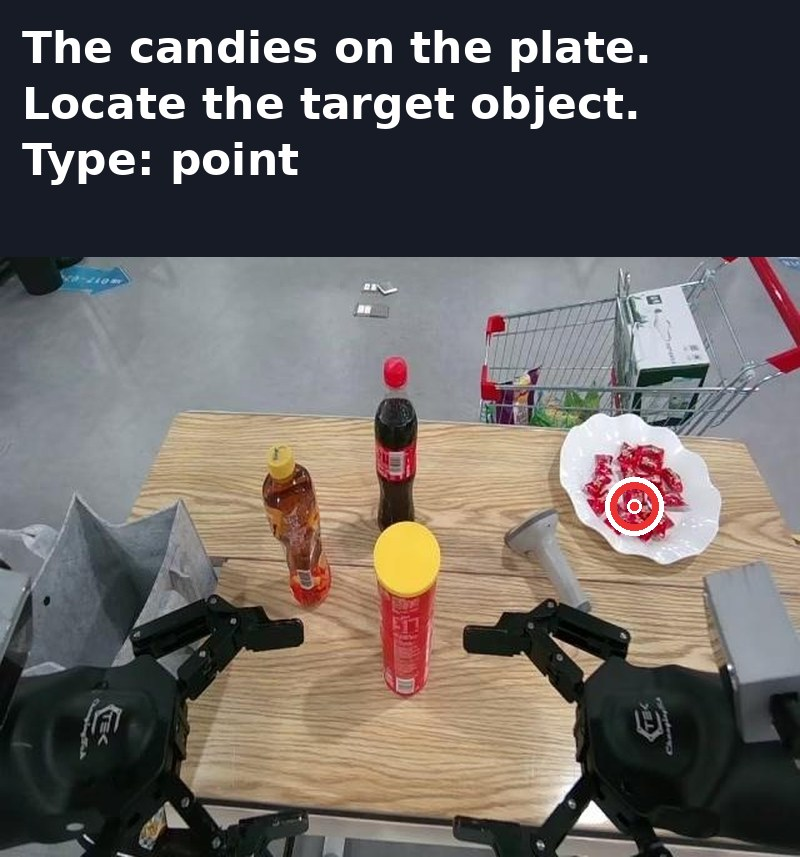</td><td width="25%">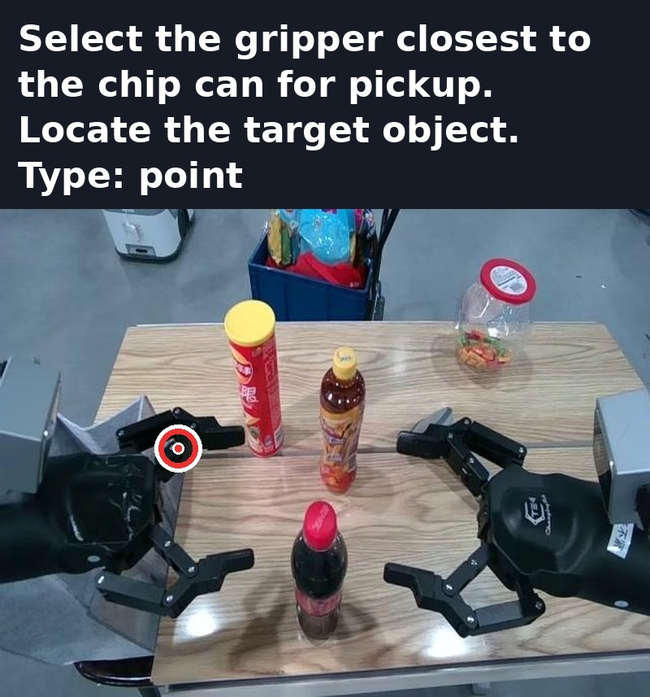</td><td width="25%">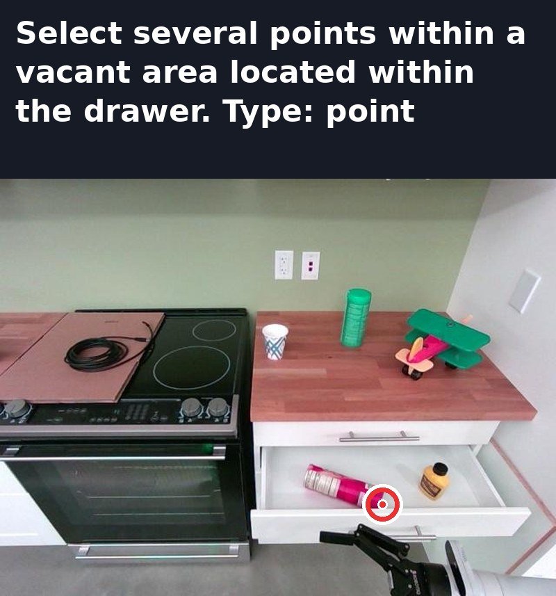</td></tr>
</table>

### Bounding-box grounding

<table>
<tr><td width="25%">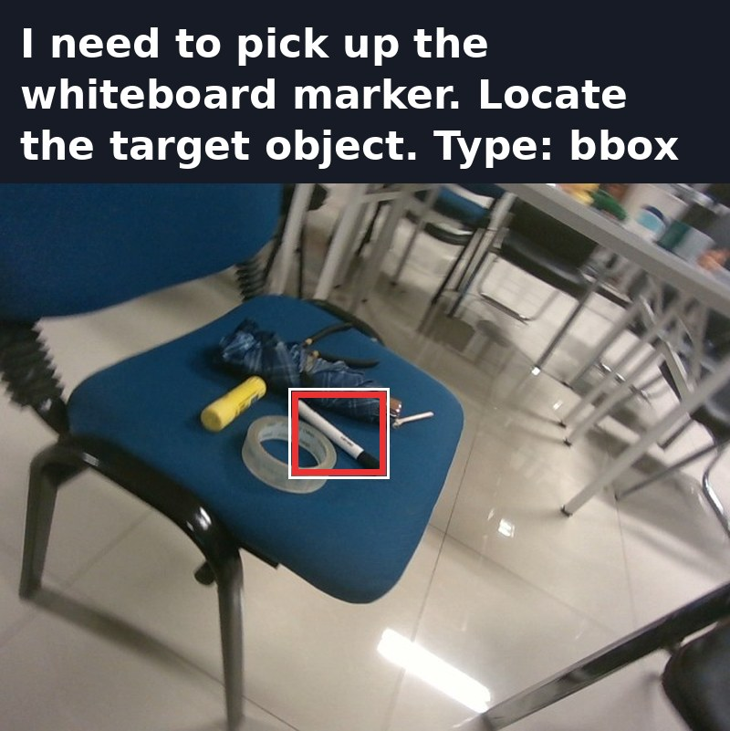</td><td width="25%">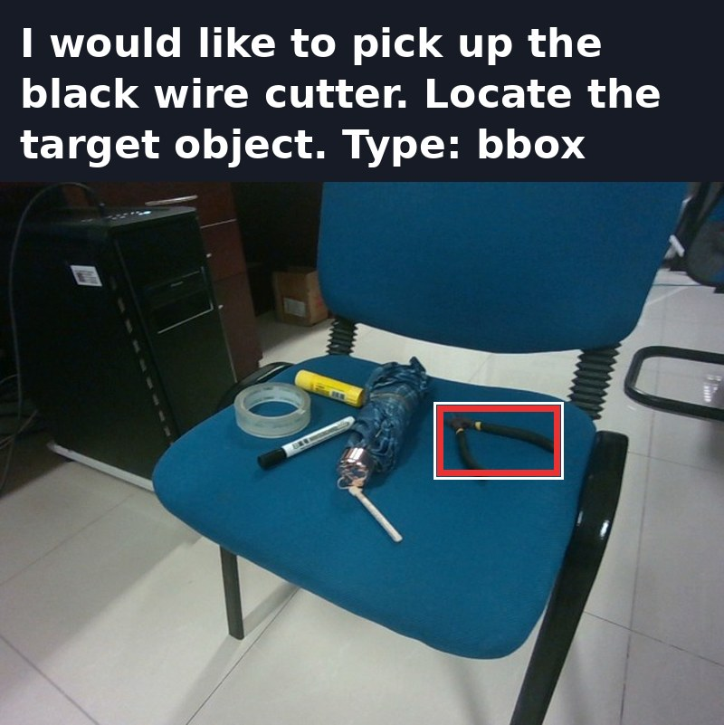</td><td width="25%">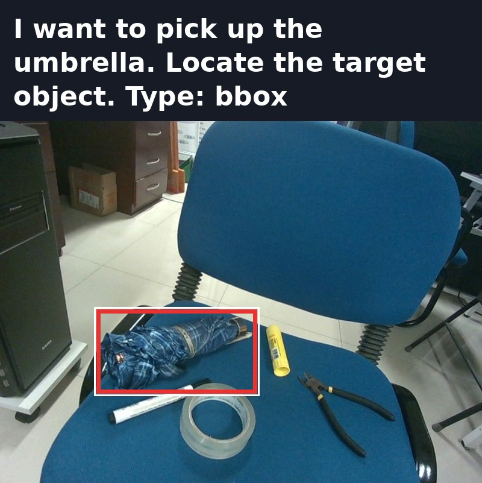</td><td width="25%">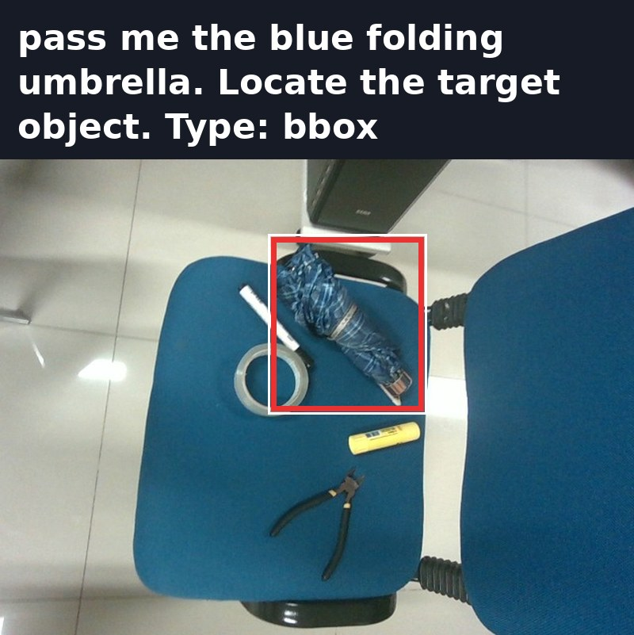</td></tr>
</table>

### Trajectory prediction

<table>
<tr><td width="25%">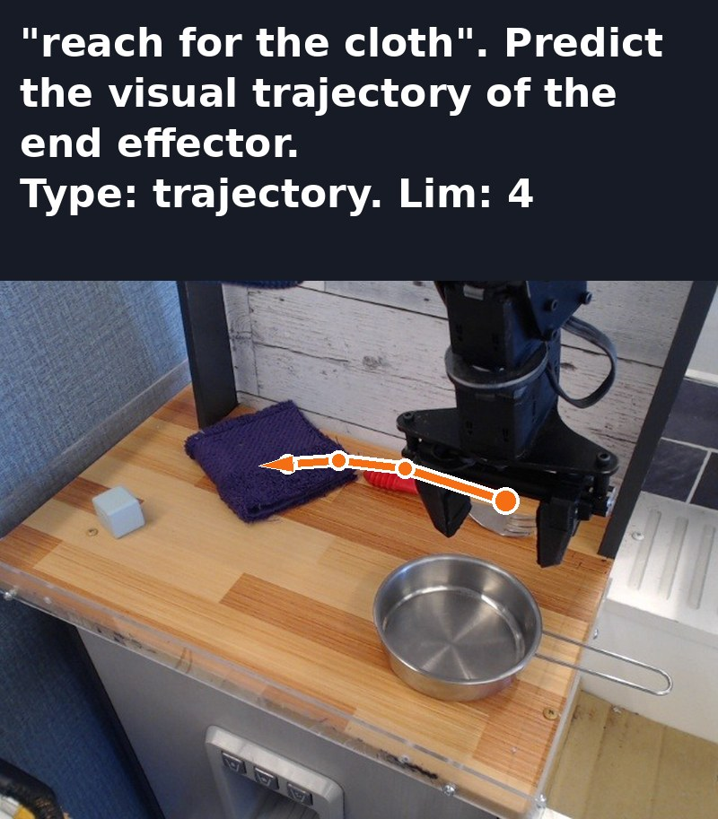</td><td width="25%">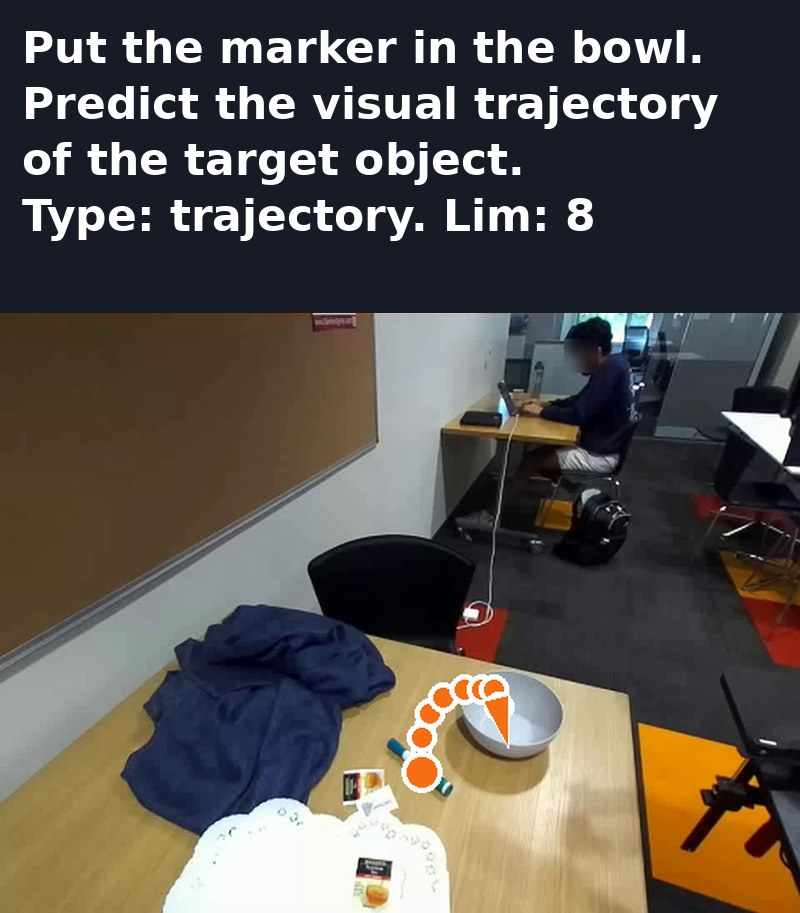</td><td width="25%">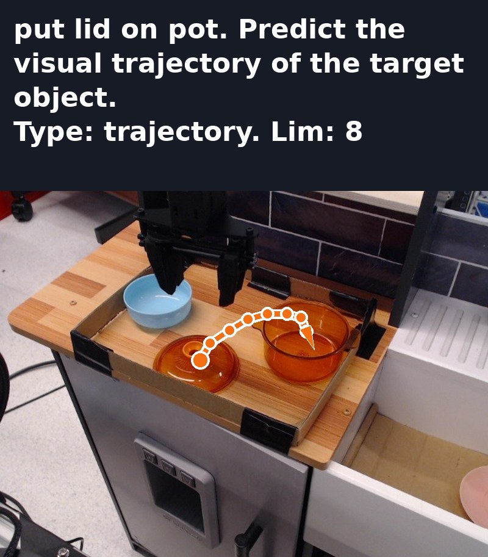</td><td width="25%">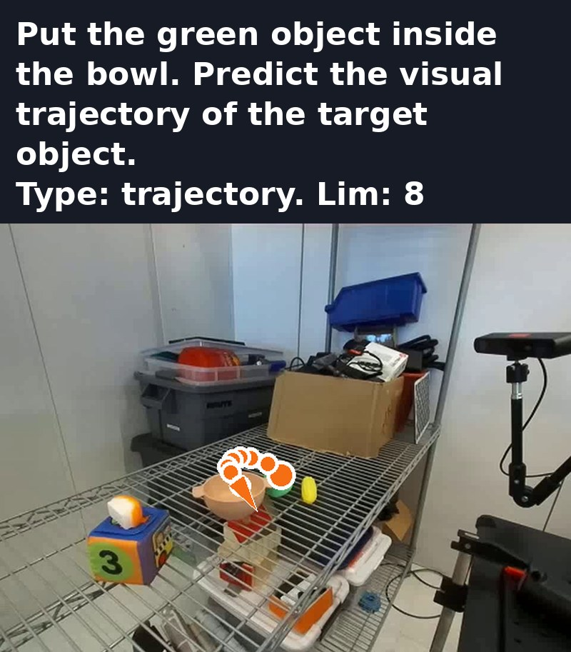</td></tr>
</table>

### Embodied VQA: future prediction

<table>
<tr><td width="50%">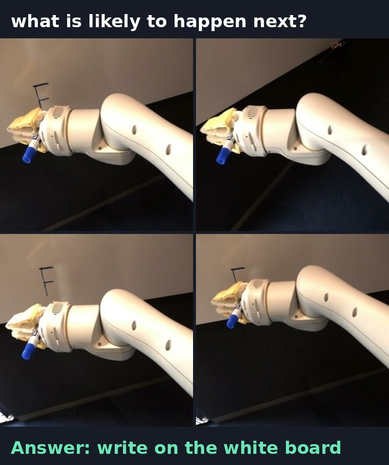</td><td width="50%">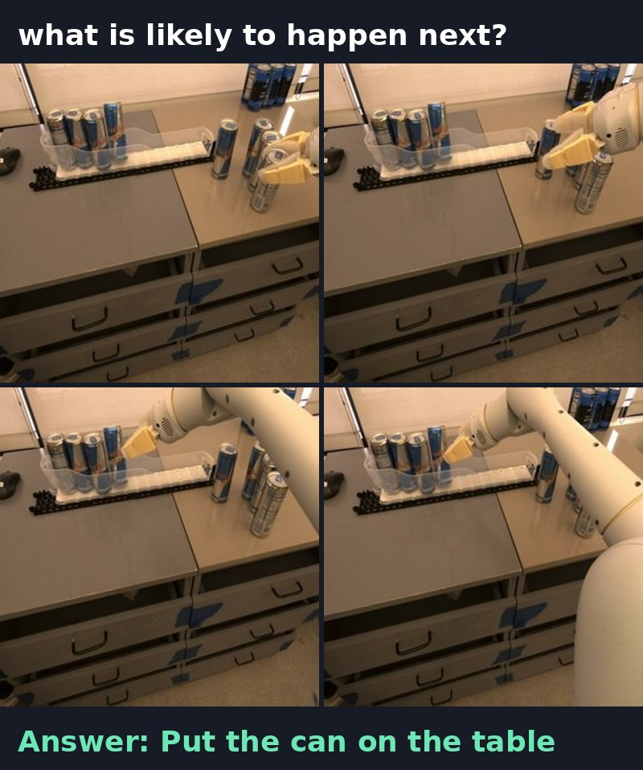</td></tr>
</table>

## Installation

### Requirements

- Python 3.12
- PyTorch 2.11.0 + CUDA 12.8
- transformers 5.17.0
- Acceleration: `flash-attn`, `flash-linear-attention`, `causal-conv1d`

### Setup

```bash
git clone <this-repo-url> PhysMoE && cd PhysMoE

conda create -n physmoe python=3.12 -y
conda activate physmoe
pip install torch==2.11.0 --index-url https://download.pytorch.org/whl/cu128
pip install transformers==5.17.0 accelerate safetensors numpy pillow
pip install flash-attn --no-build-isolation
pip install flash-linear-attention causal-conv1d
# or: pip install -r requirements.txt
```

## Quick Start

### Command line

```bash
python example/quick_start.py \
    --model-path /path/to/PhysMoE-9B \
    --image example/figs/mug_grasp.jpg \
    --prompt "You need to grasp the mug. Predict the affordance area for grasp. Type: point"
```

```text
Prompt : You need to grasp the mug. Predict the affordance area for grasp. Type: point
Answer : <|0.48048,0.508509|>
  group 0: normalized=[(0.48048, 0.508509)]  pixels=[(307.5, 244.1)]
Saved visualization to example/outputs/quick_start.jpg
```

### Python

```python
import sys; sys.path.insert(0, "model")          # makes qwen35_psmoe / pixel_fusion importable
import torch
from PIL import Image
from qwen35ps_wrapper import Qwen35PixWrapper

wrapper = Qwen35PixWrapper(
    model_name="/path/to/PhysMoE-9B",
    origin_model_path=None,
    device="cuda",
    dtype=torch.bfloat16,          # always bf16, including on CPU
    use_flash_attn=True,           # False -> SDPA
)

image = Image.open("example/figs/whiteboard_marker.jpg").convert("RGB")
prompt = "I need to pick up the whiteboard marker. Locate the target object. Type: bbox"

inputs = wrapper.process_inputs([image], text_prompt=prompt)
ids = wrapper.model.generate(**inputs, do_sample=False, repetition_penalty=1.05, max_new_tokens=256)
answer = wrapper.processor.tokenizer.batch_decode(
    ids[:, inputs["input_ids"].shape[1]:], skip_special_tokens=True)[0]
print(answer)   # <|0.4004,0.38038|><|0.528529,0.532533|>
```

`example/ps_utils.py` has helpers to parse the answer (`parse_coordinates`) and draw it (`draw_prediction`).
The reference outputs in this README were produced with greedy decoding and `repetition_penalty=1.05`.

## Prompt Format

The model is trained with a short task template after the instruction:

```text
<instruction>. <task hint>. Type: <point | bbox | trajectory>[. Lim: N]
```

| Task | Task hint (examples) | Suffix | Output |
|---|---|---|---|
| Object pointing | `Locate the target object.` | `Type: point` | `<\|x,y\|>` |
| Affordance | `Predict the affordance area for grasp.` / `Predict the affordance area.` | `Type: point` | `<\|x,y\|>` |
| Related region / free space | `Predict the related area.` | `Type: point` | `<\|x,y\|>` |
| Placement / destination | `Predict the object's final destination.` | `Type: point` | `<\|x,y\|>` |
| Single point | — | `Type: point. Lim: 1` | exactly one `<\|x,y\|>` |
| Bounding box | `Locate the target object.` / `Locate the <category>.` | `Type: bbox` | `<\|x1,y1\|><\|x2,y2\|>`, boxes separated by `,` |
| End-effector trajectory | `Predict the visual trajectory of the end effector.` | `Type: trajectory. Lim: N` | N points in order |
| Object trajectory | `Predict the visual trajectory of the target object.` | `Type: trajectory. Lim: N` | N points in order |
| VQA / planning | — | none | free text |

**Coordinate convention.** `x` is horizontal and `y` vertical, both normalized by the image width/height,
with `(0, 0)` at the top-left corner. To get pixels, multiply by the original image size:
`px = x * W, py = y * H`. Boxes are `(top-left, bottom-right)`.

**Coordinates in the input.** The tokenizer turns `<|x,y|>` anywhere in the text into a coordinate token,
in prompts as well as in answers. Values snap to the 1000-bin grid:

```python
tok = wrapper.processor.tokenizer
ids = tok.encode("Observe <|0.5,0.25|> now")   # [..., 550500, ...] = 300000 + 250*1000 + 500
tok.decode(ids)                                # 'Observe <|0.500501,0.25025|> now'
```

## Examples

```text
example/
├── figs/                 # 19 input images
├── prompt/examples.json  # image, prompt, task type and the reference PhysMoE-9B output for each demo
├── ps_utils.py           # model loading, output parsing, visualization
├── quick_start.py        # one image + one prompt
├── run_examples.py       # run all demos in prompt/examples.json
└── batch_inference.py    # batched generation, mixing coordinate and text questions
```

```bash
# Draw the reference outputs (no model, no GPU needed) -> example/outputs/
python example/run_examples.py --reference

# Run the model on all demos and compare with the reference outputs in outputs/results.jsonl
python example/run_examples.py --model-path /path/to/PhysMoE-9B

# Only some demos
python example/run_examples.py --model-path /path/to/PhysMoE-9B --only mug_handle reach_cloth

# Batched inference
python example/batch_inference.py --model-path /path/to/PhysMoE-9B
```

| Task | Demos |
|---|---|
| point | `mug_grasp`, `mug_handle`, `glass_cups`, `gripper_chip_can`, `candies_plate`, `between_mugs`, `drawer_space`, `bowl_fill` |
| bbox | `whiteboard_marker`, `wire_cutter`, `blue_umbrella`, `umbrella`, `folding_umbrella` |
| trajectory | `reach_mug`, `reach_cloth`, `mushroom_pot`, `marker_bowl`, `lid_pot`, `green_object_bowl` |

**Running on CPU.** Pass `--device cpu`. If `causal-conv1d` or `flash-linear-attention` is installed,
transformers uses their CUDA-only kernels for the Qwen3.5 linear-attention layers. `ps_utils.load_model`
therefore hides them on CPU and falls back to the PyTorch implementation. A 9B model on CPU takes minutes per answer.

## Architecture

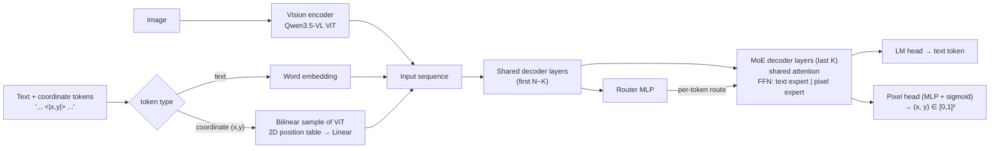

- **Coordinate token IDs.** `id = pix_start + y_bin * num_bins + x_bin` with `pix_start = 300000` and
  `num_bins = 1000`, which is beyond the text vocabulary. The tokenizer (`Qwen3_5PixTokenizer`) converts
  `<|x,y|>` to these IDs and back.
- **Router.** `router_mlp` reads the hidden state after the shared layers and predicts *text* vs.
  *coordinate* for the next token. In training the route is teacher-forced from the label; in inference it
  is the router's argmax. The same decision picks the output head.
- **MoE layers.** In the last `router_k_layers` decoder layers (8 of 32 for PhysMoE-9B) every token uses
  either the original FFN (`mlp`) or the pixel FFN (`pix_mlp`, initialized from `mlp`).
- **Pixel head.** `coord_mode="continuous"`: a 2-layer MLP with sigmoid outputs `(x, y)`.
  `coord_mode="discrete"`: per-axis softmax over bins, decoded by expectation. During `generate()`
  the predicted point is written into the logits as a single coordinate token, so standard Hugging Face
  generation (greedy, KV cache, batching) works unchanged.
- **Training loss** (code included for reference). LM cross-entropy on text tokens, router cross-entropy,
  and `lambda_coord ×` Smooth-L1 on coordinates. Optional extras: a signed-distance loss for mask-supervised
  points, EOS re-weighting and coordinate input noise.
- **Optional fused coordinate embedding** (`model/pixel_fusion.py`). It mixes the learned position embedding
  with Fourier features and the image patch feature at `(x, y)`. It is enabled with
  `use_fused_pixel_embedding: true` in the config. **The released checkpoint does not use it** and uses the
  learned position embedding only.

## Repository Structure

```text
.
├── model/
│   ├── qwen35_psmoe.py       # PhysMoE model: config, router, MoE decoder layers, pixel head, tokenizer
│   ├── qwen35ps_wrapper.py   # Qwen35PixWrapper: loading, prompt formatting, (batched) generation
│   ├── pixel_fusion.py       # optional fused coordinate embedding (not used by the released checkpoint)
│   └── qwen35_ps.py          # dense (non-MoE) variant, model_type "qwen3_5Pix"
├── example/                  # runnable demos, see "Examples"
├── resource/                 # figures used in this README
└── requirements.txt
```

## License

TBD. The example images come from the public benchmarks listed below and keep their original licenses.

## Acknowledgements

PhysMoE is built on [Qwen3.5](https://github.com/QwenLM) and Hugging Face
[transformers](https://github.com/huggingface/transformers). The example and gallery images come from
Part-Affordance-2K, PIO-Bench, Where2Place, RoboAfford, RoboRefit, ShareRobot, VABench and RoboVQA.
We thank their authors for releasing them.
